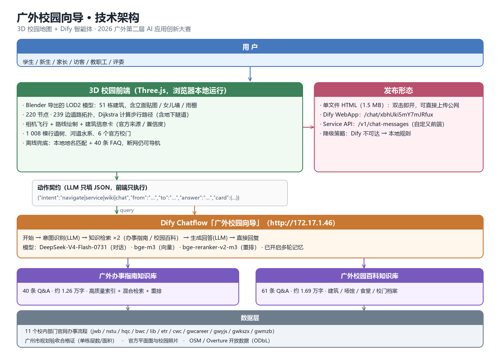

# 尚行 · GDUFS Wayfinder（广外校园向导）

**一个能回答「去哪、怎么走、带什么、找谁、现在能不能办」的校园空间智能体。**

用一句人话问「从文采园怎么去图书馆」「成绩单在哪办」，它给出一条**画在 3D 地图上的米级路线**、
一张**带房间号和办公时间的卡片**；覆盖南北两个校区、中英双语，**断网也能用**。

- 在线使用：<https://dify.gdufs.edu.cn/chat/uJIqVGKRsnkz7GY8>（校内 Dify 智能体入口）
- 本地使用：解压 `deliverables/尚行-本地客户端.zip`，双击 `启动.cmd`；或直接双击其中的 `尚行-广外校园向导.html`（单文件 2.7 MB，零依赖、可断网）
- 源码运行：`python -m http.server 8080 --directory gdufs-3d`，浏览器打开 <http://127.0.0.1:8080/>

---

## 一、作品概览

| 项 | 说明 |
|---|---|
| 作品名称 | 尚行 · GDUFS Wayfinder（广外校园向导） |
| 应用形态 | AI Agent 智能体开发 + Skill 技能开发 + 数字专家设计 |
| 主要用途 | 校园导航 + 办事指南（生活服务场景） |
| 使用对象 | 新生与家长、在校生、教师、访客与考生、国际师生、后勤与外来服务人员 |
| 典型场景 | 报到季从正门到宿舍与报到点；考试周找到「实验楼 C 区」这一级；日常办成绩单、补校园卡、医保报销、图书借阅、宿舍报修；访客入校找会场；留学生用英文问路 |
| 开发平台 | Dify 1.17.1 社区版（校内部署，入口 <https://dify.gdufs.edu.cn>）；对话 DeepSeek-V4-Flash-w8a8-mtp，向量 bge-m3，重排 bge-reranker-v2-m3 |
| 前端形态 | 自研 Three.js r128 静态页面，通过 Dify Service API 调用智能体；无构建、无 npm 依赖 |

---

## 二、选题背景与需求分析

高校并不缺地图、指南和通知，缺的是一个能把「我要办什么」翻译成「去哪、带什么、找谁、多久、现在到哪」的统一索引。具体是四个断点：

1. **空间信息与流程信息彼此割裂。** 地图知道楼在哪，却不知道这栋楼里哪间办公室办什么事；指南知道流程，却说不清这个部门在校园什么位置。
2. **粒度停在「楼栋」。** 一栋楼有多个入口、多个楼层，办事大厅有十几个窗口，用户到了楼下仍然不知道从哪个门进、上几层、找哪个窗口。
3. **两校区割裂。** 40 条高频事项里有 27 条涉及白云山校区，而现有校园地图与导航只覆盖大学城校区，问答与地图自相矛盾。
4. **通用大模型不了解广外。** 直接问「广外图书馆几层」，得到的往往是一本正经的错误答案；校园场景容错率极低——把学生指到错误的楼、给出不存在的房间号，比不回答更糟。

学校已有的「云山智服」能答制度，却答不了位置：问路先反问是哪个校区，给不出路线、距离与楼层。这正是本作品要补的那一半。

---

## 三、功能模块

| 模块 | 能力 |
|---|---|
| **M1 3D 校园地图** | 南校区 51 栋（另标八角楼）、北校区 42 栋，同一套 Blender 无头脚本生成 LOD2 模型（程序化立面、女儿墙、屋顶设备）；北校区轮廓来自学校官方平面图矢量化；含 9 个官方校门、水系与近千棵行道树；支持第一人称漫游（1.4 m/s，人眼高度 1.65 m） |
| **M2 智能导航** | 自然语言说出起终点，直接在地图上画出步行路线，标注总距离、耗时与每 100 米路标；南校 147 节点 / 156 边路网跑 Dijkstra，地面被隧道走廊切断，南北通行只走地下隧道 |
| **M3 办事指南** | 40 条事项给出部门、地点、时段、材料、电话；卡片支持一键导航到楼栋、一键拨号、一键复制材料清单、一键跳转官网原文 |
| **M4 营业状态** | 按当前时刻判断「现在能不能办」，给出今日下班时间或下次开放时间 |
| **M5 校区上下文** | 按所在校区给出对应办理点；仅另一校区可办时明确提示，并可一键切换 |
| **M6 本地客户端与双通道** | 整份作品打包成一个 2.7 MB 的 HTML，双击即用；联网时调用校内智能体，断网时自动降级为本地规则（地名匹配 + 40 条 FAQ）。中英双语，中文提问中文答、英文提问英文答 |

---

## 四、技术架构



**六层解耦**：数据层 → 知识层 → 技能层 → 智能层 → 交互层 → 用户层，层与层之间以**动作契约**（`intent / from / to / answer / card`）连接。

- **智能层：多智能体协同。** 一条 Dify Chatflow，意图路由把问题分到导航、办事、百科、闲聊四条分支，每条分支由独立专家节点处理——导航专家调用算路技能，办事专家检索办事指南库，百科专家检索校园百科库；四路专家各接回答节点，答案边生成边推流到前端，首字 4–8 秒。
- **技能层：多 Skill 集成。** 4 个可独立发布的 Skill，各带明确输入输出契约，既能被主应用组合调用，也能单独作为工具发布：
  `route-calc`（算路，内嵌 147 节点 156 边路网）、`place-lookup`（地名与别名解析）、`office-hours`（办公时段判定）、`materials-check`（材料与办理点）。
- **知识层：知识库 / RAG 双库。** 广外办事指南 40 条 12,550 字、广外校园百科 101 条 24,635 字；混合检索 + bge-reranker-v2-m3 重排，TopK 6。
- **关键提示词。** 只许使用检索结果，没有就写「官网未公布」，温度 0.1–0.3，从源头抑制编造。
- **交付形态。** Three.js、GLB 模型、路网、办事数据全部内联进一个 2.7 MB 的 HTML，双击即开，不依赖 Node / Python / 数据库，也不要求联网；联网时通过 Service API 调用校内 Dify 智能体，AI 不可达时自动降级，地图、路线、漫游、办事卡片与双语均不受影响。

---

## 五、创新点

1. **动作契约。** 大模型不直接「说完了事」，而是输出结构化动作 JSON，画线、飞相机、弹卡片全部由前端确定性代码执行。既避免「AI 说往东走、地图纹丝不动」，也让同一套智能体可被网页、小程序、公众号复用。
2. **权威数据驱动。** 建筑层数与面积取自广州市规划和自然资源局「建设工程规划验收合格证」；北校区 42 栋轮廓由学校官方平面图矢量化（400 米跑道标定 0.4178 米/像素）。每条数据记录来源与置信度，可追溯、可证伪。
3. **双通道降级。** 公网或断网环境下自动切到本地规则，不会白屏——不出现「看起来能用、现场打不开」。
4. **落到「最后一米」。** 不满足于楼栋级，直接给出房间号（如「大学城 · 行政办公楼 224 室」「白云山 · 行政楼 121 室」），并按校区自动切换。
5. **一份投入两处可用。** 4 个技能按 SKILL.md 规范封装，既能导入 Dify，也符合 WorkBuddy 的上架结构。

---

## 六、预期应用效果

- **短期（一个学期）**：接入迎新网与「一站式」办事大厅，作为新生报到与高频办事的统一入口；北校区补齐后可直接服务白云山校区师生。
- **中期**：建筑档案、路网拓扑、事项卡片均为结构化数据，可作为学校「校园数字孪生」与一站式服务大厅的基础素材，后续接入迎新网、微信公众号或校园 APP 的成本很低。
- **长期**：学校以外语外贸见长、国际师生比例高，双语与跨语言检索能力可直接复用到校际交流、留学生服务等场景；技能包可上架开放平台，供其他院校复用。

**与校内已有平台的分工。** 2026-11 用同一组问题对照：

| 同一道题 | 云山智服 | 尚行 |
|---|---|---|
| 从文采园怎么去图书馆？ | 反问哪个校区，未给路线、距离或地图 | 719 米 / 24 个路径点 / 约 10 分钟，画在 3D 地图上 |
| 图书馆有几层？ | 反问哪个校区，未给楼层 | 地上 6 层、地下 1 层、27 m、6,279 ㎡（附来源） |
| 成绩单在哪里办？ | **很强**：自助打印机点位、121 / 224 办公室、时段电话，引用 6 份文档 | 办事卡片给出部门、房间号、时段、材料、电话 |

它强在制度层（官方语料、逐条可引用），我们强在空间层（地图、米级路线、楼层房间号、断网可用）——互补而非替代：算路与 POI 可作为技能挂进智能体，也可从卡片跳转官方办事入口。

---

## 七、怎么用

**A. 本地客户端（推荐，零依赖）**

```text
解压 deliverables/尚行-本地客户端.zip
双击 启动.cmd                     # 或直接双击其中的 尚行-广外校园向导.html
```

**B. 跑源码（改代码时）**

```bash
python -m http.server 8080 --directory gdufs-3d
# 浏览器打开 http://127.0.0.1:8080/
```

地址参数：`?campus=north` 切北校区，`?lang=en` 切英文，`?ai=off` 强制离线，
`?ll=23.06829,113.3946,15` 在无 GPS 的电脑上模拟一次定位。

仓库里没有密钥：`gdufs-3d/ai-config.js` 是空模板，真实密钥只放本地的 `ai-config.local.js`（已 gitignore）。
没有密钥也能跑，只是对话降级为本地规则。

---

## 八、数据来源与可复核

- 建筑层数、面积取自广州市规划和自然资源局的**建设工程规划验收合格证**；
- 北校区 42 栋轮廓、道路、水系由学校**官方平面图矢量化**（400 米跑道标定 0.4178 米/像素）；
- 南校区路网取自 OpenStreetMap（ODbL）并按校区边界重建，车行道与人行道分级渲染；
- 办事数据来自 **11 个院部官网**的一手页面，每条都记录来源与置信度，官网没公布的明确写「官网未公布」；
- 3D 模型是**示意级 LOD2**：体块、层数、屋顶关系按官方资料还原，立面细节为程序化生成，不宣称实测。

---

## 九、仓库结构

| 目录 | 内容 |
|---|---|
| [`gdufs-3d/`](gdufs-3d/) | 产品源码（Three.js，无构建步骤），打开 `index.html` 即可运行 |
| [`data/`](data/) | 官方原始资料：平面图、验收合格证、办事数据源（含来源与置信度）、Dify 语料 |
| [`skills/`](skills/) | 4 个技能的定义（Dify DSL 与 SKILL.md），可导入复现智能体 |
| [`deliverables/`](deliverables/) | 设计方案 DOCX、架构图、本地客户端（含单文件网页）与打包 zip |
| [`docs/`](docs/) | 过程记录：交接、Dify 搭建、评分自评、建模与路网的复盘 |
| [`artifacts/blender/`](artifacts/blender/) | 重建 3D 模型所需的输入（楼宇几何与贴图） |

---

## 十、交付物

| 文件 | 说明 |
|---|---|
| [`deliverables/广外校园向导-初赛设计方案.docx`](deliverables/广外校园向导-初赛设计方案.docx) | 按官方模板填写的设计方案，7 页，含技术架构图与两张界面实拍 |
| `deliverables/尚行-本地客户端.zip` | 独立安装包：单文件网页 + 启动.cmd + README + 架构图 |
| `deliverables/广外校园向导-交付包.zip` | 合并包：设计方案 + 客户端 zip + 架构图 |
| [`deliverables/架构图.png`](deliverables/架构图.png) | 六层技术架构图 |
| 在线智能体 | <https://dify.gdufs.edu.cn/chat/uJIqVGKRsnkz7GY8> |

---

## 十一、原创性与可追溯

- 提交历史按时间记录每一次建模、算路、办事数据与界面改动，意图路由与断网降级的迭代都在里面；
- `data/official/` 是学校官方平面图与验收合格证原件，`data/service_guide/` 每条数据带来源与置信度；
- `docs/` 记录决策与故障复盘（例如 2026-11-03 推理服务故障的完整证据链）；
- 根目录的调研报告是选题依据。
