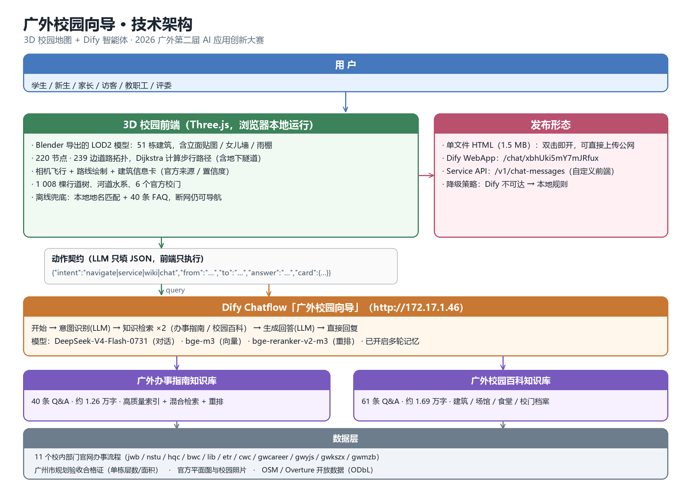

# 广外校园向导

## ——基于 3D 校园地图与 Dify 智能体的校园导航与办事指南

**参赛团队**：＿＿＿＿　**队长**：＿＿＿＿　**成员**：＿＿＿＿

**作品形态**：AI Agent（Chatflow）+ 领域数字专家（知识库）+ 自研 3D 交互前端

---

## 一、选题背景与需求分析

广东外语外贸大学大学城校区占地约 1095 亩，呈南北狭长形，教学区与生活区被中环路完全隔开，唯一的地面通道是一条地下隧道。对新生、家长和访客而言，"从文采园怎么去图书馆"这样一句简单的问题，往往要在校园里绕上二十分钟；对在校生而言，办一张成绩单、补一张校园卡，需要先在十多个部门网站之间反复跳转，才能拼出"去哪办、带什么、几点开门"。

我们调研了学校 11 个部门的官方网站，梳理出 40 条高频办事事项、58 条建筑与场馆档案，发现当前校园信息服务存在两个结构性空白：

**第一，空间信息与流程信息彼此割裂。** 地图类应用能告诉你楼在哪，却不知道"成绩单在行政楼哪间办公室办"；办事指南能告诉你流程，却说不清"这个部门在校园哪个位置、从宿舍怎么走过去"。

**第二，通用大模型不了解广外。** 直接问通用模型"广外图书馆几层"，得到的往往是一本正经的错误答案。校园场景容错率极低——把学生指到错误的楼、给出不存在的房间号，比不回答更糟。

因此我们提出"广外校园向导"：把**可交互的 3D 校园地图**与**基于官方资料的知识库智能体**合二为一，用一个入口同时回答"怎么去""去哪办""这是什么"三类问题。

---

## 二、系统总体架构

系统分三层，见架构图：

**数据层**：以学校官网（教务部、学生工作部、总务后勤部、保卫部、图书馆、现代教育技术中心、财务与资产管理部、学生就业创业中心、研究生院、考试中心、校医院等 11 个部门）的一手页面为语料来源；建筑层数、面积等硬指标采用**广州市规划和自然资源局「建设工程规划验收合格证（历史）」**——大学城各楼由广州大学城建设指挥部代建，这是目前唯一能查到单栋层数、面积与验收年份的官方一次源；空间几何采用 OpenStreetMap 与 Overture 开放数据（ODbL）。

**智能层**：Dify Chatflow「广外校园向导」，六个节点——开始 → 意图识别（LLM）→ 知识检索（办事指南库 / 校园百科库，各 TopK 6 + bge-reranker-v2-m3 重排）→ 生成回答（LLM）→ 直接回复。对话模型为 DeepSeek-V4-Flash-0731，向量模型 bge-m3。

**交互层**：Three.js 自研 3D 前端，承担模型渲染、路网寻路、相机飞行与信息卡展示。

三个关键设计决定了系统能否真正"好用"：

1. **动作契约**：LLM 不直接"说话给用户看"，而是输出一段固定结构的 JSON——`{"intent":"navigate|service|wiki|chat","from":"…","to":"…","answer":"…","card":{…}}`。前端拿到 `navigate` 就画路线、飞相机；拿到 `service` 就弹办事卡片。**模型只负责理解与组织语言，不负责画地图**，从根本上避免了"AI 说往东走、地图纹丝不动"的割裂感。
2. **双通道**：优先调用 Dify；一旦网络不通或超时，自动切换到前端内置的本地规则（地名匹配算路 + 40 条 FAQ 关键词检索）。赛事要求作品链接可公开访问，而 Dify 部署在校内网，双通道保证了任何环境下作品都能演示。
3. **单文件交付**：把 Three.js、全部数据与 Blender 导出的 3D 模型（base64 内联）打包成一个 1.5 MB 的 HTML，双击即开、可直接上传公网，绕开浏览器对本地模型文件的跨域限制。

---

## 三、功能模块说明

| 模块 | 核心能力 | 技术要点 |
|---|---|---|
| **M1 3D 校园地图** | 51 栋建筑、6 个官方校门、河道水系、1 008 棵行道树 | Blender 无头脚本生成 LOD2 模型（立面 UV 按 3.6 m 开间 × 3.6 m 层高展开、女儿墙、入口雨棚、屋顶设备），导出 GLB 供前端加载；前端保留程序化几何作为兜底 |
| **M2 智能导航** | 自然语言 → 起终点 → 步行路线 | 220 节点 / 239 边道路拓扑，Dijkstra 求最短路径；南北校区以"地下隧道"为唯一跨路通道（移除隧道后 36 组起终点全部不可达，保留后全部可达） |
| **M3 办事指南问答** | 40 条事项：部门、地点、时间、材料、流程、电话 | 知识库 Q&A 分块（按空行切分，一块一对问答）+ 混合检索 + 重排；提示词硬约束"只许使用检索结果里的信息，没有就写官网未公布" |
| **M4 建筑档案卡** | 点击建筑弹出官方档案 | 类型、层数、高度、基底面积、功能、建成年份、位置、官方来源链接、置信度；51 栋中 41 栋匹配到官方档案 |
| **M5 离线兜底与发布** | 断网可用；一键交付 | 本地 FAQ 40 条 + 地名匹配；单文件 HTML / Dify WebApp / Service API 三种发布形态 |

特别说明 **M1 的建模范式转变**：最初的校园模型是"按轮廓挤出的纯色盒子"，既没有窗，也没有屋顶细节，更谈不上"权威"。我们改为**数据驱动 + 专业建模软件**的流水线——体块数据导出为 JSON，立面贴图用脚本生成，Blender 后台模式批量建模并导出 GLB，前端按需加载。整个过程可一条命令重跑，模型因此成为可复用、可迭代的资产，而不是一次性代码。

---

## 四、预期应用效果

**面向新生与家长**：报到季最典型的问题是"宿舍怎么走""一饭在哪"。向导支持"从正门到北苑 3 栋"这类自然语言提问，直接在地图上画出路线并飞行定位，比看静态平面图直观得多。

**面向考生与访客**：广外是雅思、托福、GRE、JLPT 等社会考试的考点，考场分布在实验楼 A–E 区与教学楼 E–G 栋。向导可以精确到"实验楼 C 区"这一级，并给出从校门出发的步行路径。

**面向在校生**：40 条办事事项覆盖补办校园卡、打印成绩单、医保报销、助学贷款、图书借阅、校园网报修等高频场景，每条都带官方来源链接，可一键跳转原文核对。

**可复用价值**：建筑档案、路网拓扑、知识库语料均为结构化数据，可作为学校"校园数字孪生"与"一站式办事大厅"的基础素材；后续接入迎新网、微信公众号或校园 APP 的成本很低。

---

## 五、核心创新点

1. **权威数据驱动的校园模型**：不满足于开放地图的体块，而是用规划验收合格证逐栋校正层数与面积（如图书馆 6 层 25 526 ㎡、大会堂 2 层 8 375 ㎡），并用官方平面图核对实验楼 A–E 的区号方向。数据与来源、置信度一并存档，可追溯、可证伪。
2. **地图与智能体的动作契约**：把"理解"与"呈现"解耦——LLM 只产出结构化动作，渲染由确定性的前端代码完成。这既保证了地图响应的准确性，也让同一套智能体可以被网页、小程序、公众号等不同前端复用。
3. **双通道降级设计**：针对校园网内网部署与公网评审的现实矛盾，设计了在线 / 离线两条通路，并用徽章明示当前通道，避免"看起来能用、现场打不开"的尴尬。
4. **可复现的建模流水线**：体块导出 → 立面贴图生成 → Blender 无头建模 → GLB 导出 → 单文件打包，五步全部脚本化。任何一栋楼的数据修正后，一条命令即可重新生成整套模型与作品。

---

## 六、交付说明

| 交付物 | 说明 |
|---|---|
| 作品链接 | 单文件版 `广外校园向导.html`（1.5 MB，双击即开，可托管于任意静态服务器） |
| Dify 应用 | WebApp：`http://172.17.1.46/chat/xbhUki5mY7mJRfux`；工作流含 6 个节点、2 个知识库 |
| 数据与源码 | 3D 前端、Blender 建模脚本、知识库语料、官方资料档案（含来源与置信度）全套开源可复现 |

> 数据说明：建筑轮廓来自 OpenStreetMap（ODbL）与 Overture Maps；层数/面积来自广州市规划验收合格证；办事流程来自广外各院部官网。本作品为教学与竞赛用途，不作为测绘成果使用。
