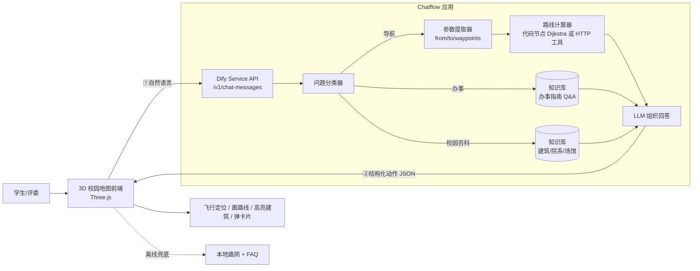

> 证据截图（rtifacts/ 下）已在 2026-10-22 清理中删除，需要时用 	ools/shot.mjs 重新生成。当前状态见 [HANDOFF.md](HANDOFF.md)。

# Dify 平台能力探查报告

> 探查对象：http://172.17.1.46 （大赛组委会部署的 Dify）
> 账号：20241003008@gdufs.edu.cn　工作区：20241003008's Workspace
> 探查方式：无头浏览器（Edge + CDP）实际登录操作 + 控制台 API 抓包核对
> 探查时间：2026-10-18
> 证据目录：`artifacts/dify/`（截图与接口原始返回）

---

## 0. 结论先行（给队长看的 5 句话）

1. **平台版本是 Dify 1.17.1 社区版**，功能完整度远高于"只能做聊天机器人"的刻板印象：工作流 18 类节点、知识库三档分段 + 混合检索 + 重排、MCP / Swagger API / 工作流复用三类工具接入、WebApp / iframe / Service API / MCP 四种对外发布方式。
2. **Dify 不做 3D 渲染，也不做地图**。它擅长的是"听懂人话 → 查知识 → 调工具 → 组织回答"。所以正确分工是：**Dify 当大脑，我们的 Three.js 校园地图当眼睛和腿**。
3. **"地图 + 导航"接进 Dify 有三条现成通道**（本机全部可用）：① HTTP 请求节点直接调我们的算路服务；② 把算路服务写成 OpenAPI 文档，用「Swagger API 作为工具」导入，一次配置全局复用；③ 加 MCP 服务，把高德/百度地图 MCP 挂上来。
4. **零外部依赖的兜底方案也存在**：校园路网只有 220 节点 / 238 条边（约 20 KB），可以直接塞进「代码执行」节点，用 Python 跑 Dijkstra，不需要公网服务器也能出路线。
5. **最大的坑是"公开访问"**：Dify 部署在 `172.17.1.46` 内网，大赛要求作品链接**可公开访问**——外网评委打不开。这一点必须在方案里提前处理（见 §9.2）。

---

## 1. 环境与账号实况

| 项目 | 实测结果 | 证据 |
|---|---|---|
| 版本 | **1.17.1**（`/console/api/version`） | `api-dump.json` |
| 版本类型 | COMMUNITY（社区版） | `system-features` |
| Marketplace | **开启**（`enable_marketplace: true`） | `system-features` |
| 插件安装权限 | 全量（`plugin_installation_scope: all`，不限于官方市场） | `system-features` |
| 工作区成员 | 1 人（肖钧元），无 RBAC | `workspaces/current/members` |
| 已有应用 | 8 个（学习辅导 / 加油华为加油China / fuck you / 333 / 111 / 222 / 提示词生成助手 / 专属智能客服） | `api-dump.json` |
| 已有知识库 | 1 个（《广外第二届AI应用创新大赛-前置背景文档》，5.5k 字，高质量·混合检索） | `api-dump.json`、`31_dataset_docs.png` |
| 已装工具插件 | **0 个**（只有 4 个内置工具） | `installedToolIds` |

**已配置模型**（走 `OpenAI-API-compatible` 供应商，应该是组委会统一网关）：

| 用途 | 模型 | 说明 |
|---|---|---|
| 对话 | **DeepSeek-V4-Flash-0731** | 工作流 LLM 节点默认模型，支持工具调用 |
| 向量化 | **bge-m3** | 知识库 Embedding |
| 重排 | **bge-reranker-v2-m3** | 混合检索的 Rerank 模型 |

> 这套组合意味着：**中文长文本 RAG、函数调用、结构化输出都能跑**，做"办事指南问答 + 意图识别"完全够用。

---

## 2. 五种应用形态（都能建）

| 形态 | Dify 内部标识 | 适合我们做什么 |
|---|---|---|
| 聊天助手 | `chat` | 最简单的问答（办事指南问答机器人） |
| Agent | `agent-chat` | 自主调用工具、多步推理（"帮我找最近的打印店并规划路线"） |
| **Chatflow（对话流）** | `advanced-chat` | **推荐主形态**：多轮对话 + 条件分支 + 知识检索 + 工具调用 |
| 工作流 | `workflow` | 无对话的批处理（如"批量把建筑清单转成导览词"） |
| 文本生成 | `completion` | 单次生成（写导览文案） |

**建议**：主应用用 **Chatflow**，另建一个小 **Workflow** 作为"路线计算器"发布成工具，供 Chatflow 调用（模块化，符合大赛"Skill/模块复用"的评分点）。

---

## 3. 工作流节点清单（实测节点面板，18 类）

来源：`21_node_palette.png`（工作流编辑器 → 添加节点）

| 分组 | 节点 | 对我们的用途 |
|---|---|---|
| 基础 | 开始、输出、Snippets | 定义入参 / 出参 / 提示词片段复用 |
| 模型 | LLM、Agent（BETA） | 意图识别、答案生成、工具型 Agent |
| 知识 | **知识检索** | 查办事指南知识库、查地点介绍 |
| 问题理解 | **问题分类器** | 把用户问题分成「导航 / 办事 / 校园百科 / 闲聊」四类 |
| 逻辑 | 条件分支、迭代、循环、人工介入 | 多地点路线串联（迭代）、异常兜底（人工介入） |
| 转换 | **代码执行（Python / NodeJS）**、模板转换、变量聚合器、文档提取器、变量赋值、**参数提取器**、列表操作 | 参数提取器把"我要从一饭去图书馆"抽成 `{from:"文采园", to:"图书馆"}`；代码节点算路 |
| 工具 | **HTTP 请求**、工具（含 MCP / Swagger / 工作流） | 调外部算路 API、调地图 MCP |

**关键判断**：`参数提取器` + `代码执行` + `HTTP 请求` 这三个节点，就是我们打通"自然语言 → 结构化起终点 → 路线"的全部积木，**不需要写后端也能跑通 demo**。

---

## 4. 知识库能力（办事指南的落地形态）

实测「知识库 → 设置」页（`32_dataset_settings.png`）：

| 维度 | 可选项 | 建议 |
|---|---|---|
| 分段模式 | 通用 / **父子（Parent-Child）** / Q&A | 办事指南用 **Q&A 模式**：一条事项 = 一问一答，命中率最高 |
| 索引模式 | **高质量**（Embedding）/ 经济（关键词） | 高质量（bge-m3） |
| 检索方式 | 向量 / 全文 / **混合检索（推荐）** | 混合检索 + Rerank（bge-reranker-v2-m3） |
| 调参 | 权重设置、Top K、Score 阈值 | Top K=4，Score 阈值 0.3 起调 |
| 元数据 | 支持给文档打 metadata | **建议加 `department` / `campus` / `building` 三个字段**，检索时按"校区/部门"过滤 |
| 多模态检索 | 可选 Vision Embedding（当前 bge-m3 不支持） | 办事指南里的流程图先转文字 |
| 导入方式 | 本地文件 / **同步自 Web 站点** / Notion / 数据源插件 | 官网办事指南可用"同步自 Web 站点"自动抓取 |
| 对外接口 | 知识库有独立「访问 API」 | 前端可直接检索（一般不用，走应用 API 更好） |

**支持的文档格式**：PDF、DOCX、MD、TXT、HTML、CSV、XLSX 等，单文件 ≤ 15 MB，每批 ≤ 5 个。

> 我们现在已有 40 条办事指南结构化语料（`data/service_guide/service_items.json`），可直接转成 Q&A 段落灌库。

---

## 5. 工具与集成体系（这是本次探查最有价值的部分）

「集成」页共 9 个板块（`int_*.png`）：

| 板块 | 实测内容 | 对"地图+导航"的意义 |
|---|---|---|
| **工具插件** | 仅内置 4 个：**代码解释器、时间、网页抓取、音频**；第三方 0 个 | 内置能力很薄，必须自己接 |
| **MCP** | 「添加 MCP 服务 (HTTP)」，支持 StreamableHTTP | ⭐ 可直接挂高德/百度地图 MCP 服务 |
| **Swagger API 作为工具** | 「创建 Swagger API 作为工具」，导入 OpenAPI/Swagger 规范即可全局复用 | ⭐⭐ 把我们的 `/route` `/poi` 接口写成 OpenAPI，就是原生工具 |
| **工作流作为工具** | 已发布的工作流可"发布为工具"，供其它应用调用 | ⭐ 路线计算器复用 |
| 数据来源 | Google Drive、Notion、Firecrawl、Jina Reader、Tavily、GitHub、Confluence… | 官网内容抓取可用 Jina Reader / Firecrawl |
| 触发器 | LangBot（QQ/微信/企微/公众号/飞书/钉钉/Telegram/Discord/Slack）、Lark、Telegram、Gmail… | 后期可做"微信公众号版校园向导" |
| Agent 策略 | Dify 官方策略、支持 MCP 的 ReAct / Function-Calling 策略 | Agent 形态要用 |
| 扩展 | **MCP server**（把 Dify 应用变成 MCP 服务器）、**OpenAI 兼容 API**、微信/企微 Bot、**Artifacts**（渲染 LLM 生成的 HTML） | Artifacts 可让 AI 直接吐一个地图/卡片 |
| 自定义端点 | 自定义模型端点 | 换模型用 |

### 5.1 三条"把地图接进 Dify"的具体路径

**路径 A：HTTP 请求节点（最快，0 学习成本）**
```
开始 → 参数提取器(抽 from/to) → HTTP 请求 GET https://our-api/route?from=..&to=..
     → 代码执行(整理成前端要的 JSON) → 输出
```
- 优点：5 分钟接好；缺点：需要一个公网可达的算路服务。

**路径 B：Swagger API 作为工具（最"正规"，评分好看）**
- 把算路服务写成 OpenAPI 3.0（`/route`、`/search_place`、`/building_info` 三个端点）
- 在「集成 → Swagger API 作为工具」里导入，得到一组工具
- Chatflow 里挂「工具」节点或 Agent 直接 function-calling
- 优点：一次配置、全局复用；工具描述会被 LLM 读取，自然语言调用准确率高

**路径 C：MCP 服务（最前沿，评委喜欢）**
- 「集成 → MCP → 添加 MCP 服务 (HTTP)」，填入高德/百度地图 MCP 的 URL + Key
- 适合"校外周边"（地铁站、公交、打车），**校内路网它算不了**，仍需我们自己的图

**路径 D（兜底，零外部依赖）：代码执行节点内置路网**
- 把 220 节点 / 238 边的图（约 20 KB JSON）写进 Python 节点，跑 Dijkstra，输出折线
- 优点：不需要任何服务器，内网也能演示；缺点：图更新要改代码

> **推荐组合**：路径 B（对外正式接口）+ 路径 D（离线兜底）。比赛现场断网也不怕。

---

## 6. 发布与对外接口（怎么让评委打开）

实测「应用 → 访问点」（`41_access_point.png`、`42_embed_*.png`）：

| 方式 | 实测值 | 说明 |
|---|---|---|
| **Web 应用** | `http://172.17.1.46/chat/XeLtI8aB7W9DiSWa` | 每应用一个公开 token，可直接分享 |
| **iframe 嵌入** | `<iframe src="http://172.17.1.46/chatbot/XeLtI8aB7W9DiSWa" ...>` | 5 行代码嵌进我们的 3D 页面 |
| **后端服务 API** | `http://172.17.1.46/v1` + API 密钥（当前 0 个，需新建） | 自定义前端首选，`/v1/chat-messages`、`/v1/workflows/run` |
| **MCP 服务** | 显示"不可用" | 需从 Marketplace 装 `MCP server` 扩展后才能开 |
| 自定义前端 | Fork Dify-WebClient → 改品牌 → Vercel 部署，配 `NEXT_PUBLIC_APP_ID/APP_KEY/API_URL` | 可做"广外定制皮肤" |
| 其它 | 标注（人工纠正答案）、日志、监测（会话数/Token/费用） | 答辩时可展示"运营数据" |

---

## 7. 新特性：Agents BETA 与 Skills（对应大赛"Skill"赛道）

- **Agents（BETA）**：工作区里已经有一个「校园智能生活助手」（2026-10-18 11:10 创建），说明同学已经试过 Agent 形态。
- **Skills**：支持导入 **`SKILL.md`（agentskills.io 规范）的 .zip 包**，也可以用「Skill Builder」用自然语言生成 Skill 草稿。
  → 如果大赛要交"Skill"形态作品，**把"校园算路 + 地点检索"封装成一个 SKILL.md 技能包**，是很好的加分项，且与 Dify 应用天然兼容。

---

## 8. 能力边界（别踩的坑）

| 限制 | 说明 | 应对 |
|---|---|---|
| 不做地图/3D | Dify 没有任何地理渲染能力 | 前端自己画（我们已有 Three.js） |
| 内置工具很少 | 只有 4 个，联网搜索要自己装插件 | 装 Tavily/Firecrawl，或自建 HTTP 工具 |
| 代码节点有沙箱限制 | 无外网、库受限、执行时长有限 | 算路用纯 Python 标准库，不引第三方包 |
| 上下文/输出长度 | 长回答会被截断或变慢 | 路线结果用 JSON，前端自己渲染文案 |
| 内网地址 | `172.17.1.46` 外网不可达 | 见 §9.2 |
| 单账号并发 | 社区版无高可用 | 演示用，别做压测 |

---

## 9. 与选题结合：三种展现形式

### 9.1 形式对比

| 方案 | 做法 | 优点 | 缺点 | 适用 |
|---|---|---|---|---|
| **A. 纯 WebApp** | 直接用 Dify 的 `/chat/xxx` 页面 | 10 分钟上线，零开发 | 没有地图，只有文字；和"导航"选题不匹配 | 交差/兜底 |
| **B. iframe 嵌 Chat** | 3D 页面右下角嵌 Dify 聊天窗 | 30 分钟，能看 | 地图与对话是"两张皮"，AI 说"往东走"地图不会动 | 快速演示 |
| **C. 自定义前端 + Service API（推荐）** | 3D 地图为主界面；对话走 `/v1/chat-messages`；Dify 返回结构化指令，前端执行（飞行定位、画路线、高亮建筑） | 真正的"AI + 地图"一体；可拿技术复杂度分 | 需要写前端对接（我们已有基础） | **主方案** |
| **D. Dify 当 MCP 服务** | 把 Dify 应用暴露成 MCP，我们的前端当 MCP Client | 架构最"新"，答辩亮点 | 需装扩展，稳定性一般 | 加分项/备选 |

### 9.2 "可公开访问"的坑（必须现在决定）

大赛明确要求"作品链接可公开访问"。当前 Dify 在 `172.17.1.46`，**外网评委打不开**。三种解法：

1. **前端静态托管到公网 + 前端内置"离线规则引擎"**：3D 页面放 Vercel/GitHub Pages，没有 Dify 也能导航（本地算路 + 本地 FAQ），有 Dify 时自动增强。**最稳**。
2. **内网穿透**（cloudflared / frp）把 Dify 暴露到公网临时域名，页面直接调。演示期可用，评审期有掉线风险。
3. **双链接**：交"公网 3D 演示页"+"Dify WebApp 链接 + 录屏"。评委能点开，也能看到 Dify 工作流。

> 建议选 **1 + 3 组合**：公网页面永远能打开，Dify 作为"在线大脑"可选接入。

### 9.3 推荐架构



### 9.4 前后端契约（建议直接在 Dify 输出节点里产出这段 JSON）

```json
{
  "intent": "navigate",
  "from": {"name": "文采园（一饭）", "id": "B025"},
  "to": {"name": "大学城校区图书馆", "id": "B002"},
  "route": {
    "distance_m": 844,
    "duration_min": 12,
    "polyline": [[x, z], ...],
    "steps": [{"text": "沿中环东路向南 120 米", "turn": "straight"}]
  },
  "answer": "从文采园出发，沿中环东路向南……",
  "card": {"title": "图书馆", "desc": "6 层，2.8 万㎡，考试周 24 小时开放", "url": "..."}
}
```

前端拿到 `intent=navigate` 就飞相机、画 `polyline`；拿到 `intent=service` 就弹办事卡片。**LLM 只负责"填 JSON"，不负责"画地图"**——这样最稳。

---

## 10. 本周可落地的动作清单

| 优先级 | 动作 | 产出 |
|---|---|---|
| P0 | 建知识库「广外办事指南」，Q&A 分段，导入 40 条语料 | 可问答的知识库 |
| P0 | 建 Chatflow「广外校园向导」，分类器 + 参数提取 + 知识检索 + 回答 | 可对话的应用 |
| P0 | 前端接 `/v1/chat-messages`，解析 JSON 动作 | 地图会动 |
| P1 | 把算路封装成工作流 → 发布为工具 | 模块化，加分 |
| P1 | 写 OpenAPI（3 个端点）→ Swagger 工具导入 | 技术复杂度加分 |
| P2 | 装 MCP server 扩展，把应用暴露成 MCP | 答辩亮点 |
| P2 | 高德 MCP（校外接驳） | 完整性加分 |

---

## 附：证据索引

| 文件 | 内容 |
|---|---|
| `artifacts/dify/01_after_login.png` | 工作区主页 |
| `artifacts/dify/21_node_palette.png` | 工作流 18 类节点面板 |
| `artifacts/dify/22_publish_dialog.png` | 发布菜单（Web 应用/访问点/发布为工具） |
| `artifacts/dify/32_dataset_settings.png` | 知识库分段/索引/检索设置 |
| `artifacts/dify/int_mcp.png` `int_api.png` `int_wf.png` | MCP / Swagger / 工作流作为工具 |
| `artifacts/dify/int_extension.png` | 扩展（MCP server、OpenAI 兼容、Artifacts、微信 Bot） |
| `artifacts/dify/41_access_point.png` | 访问点（WebApp / iframe / API / MCP） |
| `artifacts/dify/50_agents.png` `50_skills.png` | Agents BETA 与 Skills |
| `artifacts/dify/api-dump.json` | 应用/知识库/模型/插件原始接口返回 |
